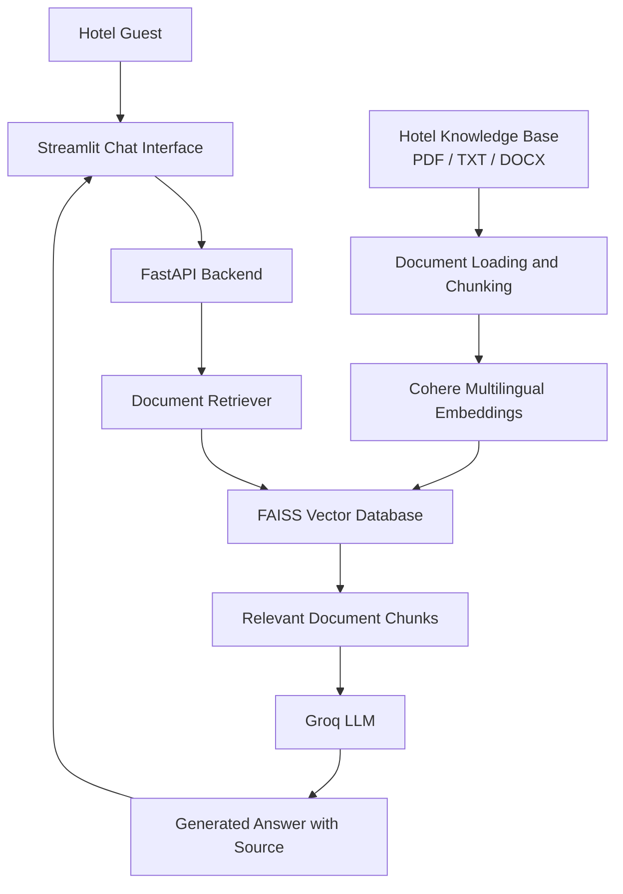

<p align="center">
  
</p>

<h1 align="center"> Oman Hospitality AI Assistant</h1>

<p align="center">
  <strong>Multilingual AI-Powered Hotel Assistant</strong><br>
  Built with Python, Generative AI and Retrieval-Augmented Generation (RAG)
</p>

<p align="center">
  Supporting English 🇬🇧 | French 🇫🇷 | Arabic 🇸🇦
</p>

<p align="center">
  <a href="https://sahab-oasis-frontend.onrender.com">
    🚀 Live Demo
  </a>
  &nbsp; | &nbsp;
  <a href="https://hospitality-assistant.onrender.com/docs">
    📚 API Documentation
  </a>
  &nbsp; | &nbsp;
  <a href="https://github.com/brahimazreg/hospitality-assistant">
    💻 GitHub Repository
  </a>
</p>

---
<p align="center">

  **🚀 Live Demo**

  [Open the Oman Hospitality AI Assistant](https://sahab-oasis-frontend.onrender.com)

  [Backend API Documentation](https://hospitality-assistant.onrender.com/docs)

</p>

---

## 📌 Project Overview

The Oman Hospitality AI Assistant helps hotel guests get information quickly through a conversational interface.

It retrieves relevant information from hotel documents and uses a Large Language Model (LLM) to generate contextual answers.

The assistant supports three languages:

- 🇬🇧 English
- 🇫🇷 French
- 🇸🇦 Arabic

Answers include source references whenever available.

## 🏗️ System Architecture



## ✨ Features

- Multilingual conversations: English, French, and Arabic.
- Retrieval-Augmented Generation (RAG).
- PDF, TXT, and DOCX document support.
- Semantic document search using FAISS.
- Multilingual embeddings using Cohere.
- Contextual answer generation using Groq.
- Source references in generated answers.
- FastAPI REST API.
- Interactive Streamlit interface.
- Docker containerization.
- Cloud deployment using Render.

## 🛠️ Technology Stack

| Component | Technology |
|---|---|
| Programming Language | Python |
| LLM | Groq |
| Embeddings | Cohere |
| Embedding Model | embed-multilingual-v3.0 |
| Vector Database | FAISS |
| RAG Framework | LangChain |
| Backend | FastAPI |
| Frontend | Streamlit |
| Containerization | Docker |
| Deployment | Render |
| Version Control | Git and GitHub |

## 🖥️ Application Preview

The application provides a multilingual chat interface where guests can ask questions and receive answers grounded in hotel documents.

<!-- Add your application screenshot here after uploading it to the repository. -->

Example:

```text
Question: What time does breakfast start?

Answer: Breakfast at Sahab Oasis Hotel starts at 06:30
and is served until 10:30.

Source: hotel_services.docx
```

## 🌍 Live Application

| Service | URL |
|---|---|
| Streamlit Frontend | https://sahab-oasis-frontend.onrender.com |
| FastAPI Backend | https://hospitality-assistant.onrender.com |
| Swagger API Docs | https://hospitality-assistant.onrender.com/docs |

**Deployment note:** Render free services may sleep after inactivity. The first request can take longer while services wake up. Their filesystem is ephemeral, so the FAISS index may need to be recreated after a restart or redeployment.

## 🚀 Run Locally


### 2. Create a virtual environment

```bash
python -m venv .venv
```

Activate it:

**Windows PowerShell**

```powershell
.venv\Scripts\Activate.ps1
```

**macOS / Linux**

```bash
source .venv/bin/activate
```

### 3. Install dependencies

```bash
pip install -r requirements.txt
```

### 4. Configure environment variables

Create a `.env` file in the project root:

```env
GROQ_API_KEY=your_groq_api_key
COHERE_API_KEY=your_cohere_api_key
```

Never commit your `.env` file or expose API keys publicly.

### 5. Start the FastAPI backend

```bash
uvicorn app.main:app --reload
```

Backend:

```text
http://127.0.0.1:8000
```

API documentation:

```text
http://127.0.0.1:8000/docs
```

### 6. Start the Streamlit frontend

Open a second terminal.

**Windows PowerShell**

```powershell
$env:API_URL="http://127.0.0.1:8000/ask"
streamlit run app/streamlit_app.py
```

**macOS / Linux**

```bash
export API_URL="http://127.0.0.1:8000/ask"
streamlit run app/streamlit_app.py
```

Open the local Streamlit URL displayed in your terminal.

## 🐳 Run with Docker

Make sure Docker is running.

```bash
docker compose up --build
```

Services:

| Service | Local URL |
|---|---|
| Streamlit | http://localhost:8502 |
| FastAPI | http://localhost:8000 |
| Swagger | http://localhost:8000/docs |

Stop the containers:

```bash
docker compose down
```

## 🔌 API Example

### POST `/ask`

Request:

```json
{
  "question": "What time does breakfast start?"
}
```

Example response:

```json
{
  "question": "What time does breakfast start?",
  "answer": "Breakfast at Sahab Oasis Hotel starts at 06:30 and is served until 10:30."
}
```

The exact answer wording may vary depending on the retrieved context.

## 📂 Project Structure

```text
project-01-hospitality-assistant/
│
├── app/
│   ├── main.py
│   └── streamlit_app.py
│── assets/Sahab Oasis Hotel AI Assistant.png
├── data/
│   └── knowledge_base/
│
├── src/
│   ├── embeddings.py
│   ├── generator.py
│   ├── retriever.py
│   └── vector_store.py
│
├── config.py
├── requirements.txt
├── Dockerfile
├── docker-compose.yml
├── start_backend.sh
├── start_frontend.sh
├── .gitignore
└── README.md
```

## 🔐 Security

- API keys are stored in environment variables.
- `.env` is excluded from Git.
- Backend credentials are configured privately on Render.
- The frontend uses the `API_URL` environment variable to communicate with the backend.

## ✅ Project Status

**Completed and deployed.**

The public application has been tested successfully in:

- English
- French
- Arabic

The three language tests returned hotel information with references to the knowledge-base source document.

---

**Project 1 of 6 — AI Application Portfolio**

Built with Python, RAG, LangChain, Cohere, FAISS, Groq, FastAPI, Streamlit, and Docker.
